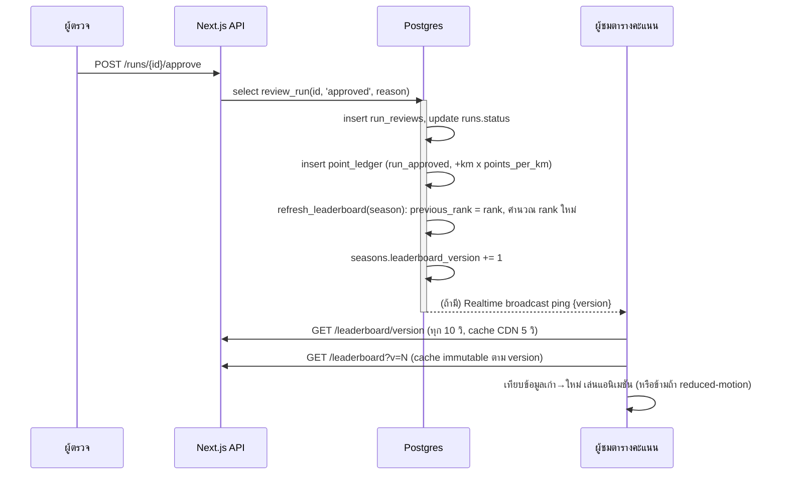

# workingRun — ขั้นที่ 2: ER Diagram และการออกแบบฐานข้อมูล

> สถานะ: **รอผู้ใช้ตรวจ** · Postgres 15+ (Supabase) · ทุก timestamp เป็น `timestamptz` เก็บ UTC
> วันที่วิ่ง (`run_date`) เป็น `date` ที่ตีความตามเวลา **Asia/Bangkok** เพราะเป็น "วันตามปฏิทินของผู้ใช้" ไม่ใช่จุดเวลา

## 1. ER Diagram

```mermaid
erDiagram
    departments ||--o{ profiles : "สังกัด (ไม่บังคับ)"
    profiles ||--o{ user_roles : "มีบทบาท"
    profiles ||--o{ season_participants : "มีสิทธิ์เล่น"
    seasons ||--o{ season_participants : "ผู้มีสิทธิ์"
    seasons ||--o{ season_rules : "กติกา (มีเวอร์ชัน)"
    seasons ||--o{ runs : "รายการวิ่งในฤดูกาล"
    profiles ||--o{ runs : "บันทึก"
    season_rules ||--o{ runs : "กติกาที่ใช้ตอนส่ง"
    runs ||--o{ evidence_files : "รูปหลักฐาน"
    runs ||--o{ run_flags : "ธงผิดปกติ"
    runs ||--o{ run_reviews : "ประวัติการตรวจ"
    profiles ||--o{ run_reviews : "ผู้ตรวจ"
    seasons ||--o{ point_ledger : "รายการคะแนน"
    profiles ||--o{ point_ledger : "เจ้าของคะแนน"
    runs |o--o{ point_ledger : "ที่มาของคะแนน"
    season_rules |o--o{ point_ledger : "อัตราที่ใช้คำนวณ"
    seasons ||--o{ leaderboard_entries : "ตารางคะแนน"
    profiles ||--o{ leaderboard_entries : "อันดับ"
    profiles ||--o{ audit_logs : "ผู้กระทำ"
    profiles ||--o{ data_deletion_requests : "ขอลบข้อมูล"

    departments {
        uuid id PK
        text code UK "unique เฉพาะที่ยังไม่ลบ"
        text name_th
        text name_en
        timestamptz created_at
        timestamptz updated_at
        timestamptz deleted_at "soft delete"
    }

    profiles {
        uuid id PK
        uuid auth_user_id UK "FK auth.users, NULL หลังลบข้อมูล"
        citext employee_code UK "username, NULL หลัง anonymize"
        text display_name "ชื่อที่แสดงบนตาราง"
        uuid department_id FK "NULL ได้"
        text locale "th or en"
        boolean must_change_password
        boolean is_active
        text privacy_notice_version
        timestamptz consented_at
        timestamptz anonymized_at "PDPA"
        timestamptz created_at
        timestamptz updated_at
        timestamptz deleted_at "soft delete"
    }

    user_roles {
        uuid user_id PK,FK
        app_role role PK "runner approver admin"
        uuid granted_by FK
        timestamptz granted_at
    }

    seasons {
        uuid id PK
        text name_th
        text name_en
        date start_date
        date end_date "CHECK end >= start"
        season_status status "draft active closed"
        smallint review_grace_days
        bigint leaderboard_version "เพิ่มทุกครั้งที่อันดับเปลี่ยน"
        timestamptz closed_at
        uuid closed_by FK
        uuid created_by FK
        timestamptz created_at
        timestamptz updated_at
        timestamptz deleted_at "ลบได้เฉพาะ draft"
    }

    season_rules {
        uuid id PK
        uuid season_id FK
        int version UK "unique ต่อ season"
        numeric points_per_km "> 0"
        numeric min_distance_km "ค่าเริ่ม 0.1"
        smallint max_backdate_days "ค่าเริ่ม 7"
        smallint max_evidence_files "ค่าเริ่ม 3"
        int flag_min_pace_sec_per_km "ค่าเริ่ม 180"
        int flag_max_pace_sec_per_km "ค่าเริ่ม 1200"
        numeric flag_max_distance_km "ค่าเริ่ม 42.2"
        numeric flag_max_daily_km "ค่าเริ่ม 50"
        text change_reason
        uuid created_by FK
        timestamptz created_at
    }

    season_participants {
        uuid season_id PK,FK
        uuid user_id PK,FK
        uuid added_by FK
        timestamptz added_at
        timestamptz removed_at "soft delete"
    }

    runs {
        uuid id PK
        uuid user_id FK
        uuid season_id FK
        uuid rule_id FK "กติกาที่ใช้ตรวจตอนส่ง"
        date run_date "Asia/Bangkok"
        numeric distance_km "CHECK > 0"
        int duration_seconds "CHECK > 0"
        int pace_sec_per_km "generated"
        text note "ไม่บังคับ <= 280"
        run_status status "pending approved rejected cancelled revoked"
        timestamptz submitted_at "ใช้ตัดสินอันดับเท่ากัน"
        timestamptz decided_at
        timestamptz created_at
        timestamptz updated_at
    }

    run_flags {
        uuid run_id PK,FK
        flag_code code PK
        jsonb detail "เช่น ค่าที่วัดได้กับเกณฑ์"
        timestamptz created_at
    }

    run_reviews {
        uuid id PK
        uuid run_id FK
        uuid reviewer_id FK
        review_decision decision "approved rejected revoked"
        text reason "บังคับเมื่อ rejected หรือ revoked"
        timestamptz created_at
    }

    evidence_files {
        uuid id PK
        uuid run_id FK
        text storage_provider "r2 or supabase"
        text object_key UK
        text content_sha256 "ตรวจรูปซ้ำ"
        text mime_type
        int byte_size "CHECK <= 2MB"
        timestamptz uploaded_at
        timestamptz purge_after "uploaded_at + 90 วัน"
        timestamptz purged_at
    }

    point_ledger {
        bigint id PK
        uuid season_id FK
        uuid user_id FK
        uuid run_id FK "NULL ถ้าปรับมือ"
        uuid rule_id FK
        ledger_entry_type entry_type "run_approved run_revoked manual_adjustment rule_recalc"
        numeric points "มีเครื่องหมาย ห้าม 0"
        numeric distance_km "มีเครื่องหมาย"
        timestamptz effective_at "เวลาที่ใช้ตัดสินอันดับเท่ากัน"
        text reason
        uuid created_by FK "ใครทำ"
        timestamptz created_at "ทำเมื่อไหร่"
    }

    leaderboard_entries {
        uuid season_id PK,FK
        uuid user_id PK,FK
        numeric total_points
        numeric total_distance_km
        int approved_run_count
        timestamptz reached_at "ถึงคะแนนปัจจุบันเมื่อไหร่"
        int rank
        int previous_rank
        timestamptz updated_at
    }

    audit_logs {
        bigint id PK
        uuid actor_id FK "NULL = ระบบ"
        text action
        text entity_type
        uuid entity_id
        jsonb before_data
        jsonb after_data
        text reason
        timestamptz created_at
    }

    data_deletion_requests {
        uuid id PK
        uuid user_id FK
        uuid requested_by FK
        deletion_status status "pending completed rejected"
        text note
        uuid processed_by FK
        timestamptz requested_at
        timestamptz processed_at
    }

    system_settings {
        smallint id PK "CHECK id = 1 singleton"
        smallint evidence_retention_days "ค่าเริ่ม 90"
        smallint audit_retention_days "ค่าเริ่ม 730"
        text current_privacy_notice_version
        timestamptz updated_at
        uuid updated_by FK
    }

    login_attempts {
        bigint id PK
        text username_hash "SHA-256 ไม่เก็บ username ดิบ"
        text ip_hash
        boolean succeeded
        timestamptz created_at "ลบเมื่อเกิน 30 วัน"
    }
```



## 2. คำอธิบายแต่ละตาราง

### กลุ่มผู้ใช้และองค์กร

| ตาราง | หน้าที่ | หมายเหตุ |
|---|---|---|
| `departments` | แผนก | soft delete; `code` unique เฉพาะแถวที่ `deleted_at IS NULL` (partial unique index) เพื่อให้ใช้รหัสเดิมซ้ำได้หลังลบ |
| `profiles` | ข้อมูลผู้ใช้ 1:1 กับ `auth.users` | เก็บแค่ **รหัสพนักงาน + ชื่อที่แสดง + แผนก** (PDPA: เก็บเท่าที่จำเป็น) ไม่มีอีเมล/เบอร์โทร · `id` แยกจาก `auth_user_id` เพื่อให้ลบบัญชี auth ได้โดยคะแนนเดิม/ledger ยังอ้างถึง `profiles.id` อยู่ |
| `user_roles` | บทบาท (หลายบทบาทต่อคนได้) | ตารางเชื่อมแทนคอลัมน์ array เพื่อเก็บว่าใครให้สิทธิ์ เมื่อไหร่ · RLS ใช้ฟังก์ชัน `has_role()` |

### กลุ่มฤดูกาลและกติกา

| ตาราง | หน้าที่ | หมายเหตุ |
|---|---|---|
| `seasons` | ฤดูกาล | **exclusion constraint** (`btree_gist`) ห้ามช่วงวันทับกัน + partial unique index ให้ `status='active'` มีได้ 1 แถว · `leaderboard_version` ใช้กับกลไก real-time แบบ polling |
| `season_rules` | กติกาคะแนนและเกณฑ์ผิดปกติ **แบบมีเวอร์ชัน** | ไม่แก้แถวเดิม — แก้กติกา = insert เวอร์ชันใหม่พร้อมเหตุผล → ตรวจย้อนหลังได้ว่าแต่ละรายการใช้กติกาไหน · กติกาปัจจุบัน = เวอร์ชันสูงสุดของฤดูกาล |
| `season_participants` | รายชื่อพนักงานที่มีสิทธิ์เล่นในแต่ละฤดูกาล | แอดมินนำเข้าจาก CSV หรือคัดลอกจากฤดูกาลก่อน · soft delete ด้วย `removed_at` |

### กลุ่มการวิ่ง

| ตาราง | หน้าที่ | หมายเหตุ |
|---|---|---|
| `runs` | รายการวิ่ง | กฎ "ห้ามส่ง" ตรวจด้วย trigger `BEFORE INSERT` (ต้องดูกติกาฤดูกาลและวันปัจจุบันของกรุงเทพฯ ซึ่ง CHECK ทำไม่ได้) · CHECK ระดับคอลัมน์: ระยะ > 0, ≤ 999.99, เวลา > 0 · `pace_sec_per_km` เป็น generated column · ไม่มี soft delete — ใช้สถานะ `cancelled` แทน (ผู้ใช้ยกเลิกเองได้ตอน pending) |
| `run_flags` | ธงผิดปกติของแต่ละรายการ | 1 แถวต่อ 1 ประเภทธง (normalized แทน array) → query "รายการที่ติดธง pace" ใช้ index ได้ · trigger `AFTER INSERT` บน `runs` เป็นคนสร้าง |
| `run_reviews` | ประวัติการอนุมัติ/ปฏิเสธ/เพิกถอน | append-only — การเปลี่ยนใจภายหลังเป็นแถวใหม่ ไม่แก้แถวเดิม · CHECK: `reason` ต้องไม่ว่างเมื่อ rejected/revoked · trigger: ผู้ตรวจห้ามตรวจรายการของตัวเอง |
| `evidence_files` | metadata ของรูปหลักฐาน (ไฟล์จริงอยู่ R2) | `purge_after` คำนวณตอน insert จาก `system_settings.evidence_retention_days` · job รายวันลบไฟล์ที่ `purge_after < now()` แล้วตั้ง `purged_at` (เก็บแถวไว้เพื่อแสดง "หลักฐานถูกลบตามนโยบาย") · `content_sha256` ใช้ติดธงรูปซ้ำ |

### กลุ่มคะแนน

| ตาราง | หน้าที่ | หมายเหตุ |
|---|---|---|
| `point_ledger` | **แหล่งความจริงเดียวของคะแนน** — ทุกการเปลี่ยนแปลงคะแนนเป็น 1 แถว | append-only (trigger บล็อก UPDATE/DELETE) · ตอบโจทย์ "ใคร (`created_by`) ทำเมื่อไหร่ (`created_at`) เพราะอะไร (`reason`, `entry_type`, `run_id`)" · เพิกถอน = แถวติดลบ ไม่ลบของเดิม · unique partial index: 1 รายการวิ่งมี `run_approved` ได้ครั้งเดียว |
| `leaderboard_entries` | ตารางคะแนนที่คำนวณแล้ว (denormalized cache) | อัปเดตโดยฟังก์ชัน `refresh_leaderboard(season_id)` หลังมีแถวใน ledger · เก็บ `previous_rank` เพื่อแสดง ▲/▼ · ฤดูกาลที่ปิดแล้วแถวเหล่านี้คือ "ผลสุดท้าย" ที่ดูย้อนหลังได้ — ไม่ต้องมีตาราง snapshot แยก |

### กลุ่มตรวจสอบและ PDPA

| ตาราง | หน้าที่ | หมายเหตุ |
|---|---|---|
| `audit_logs` | บันทึกการเปลี่ยนแปลงข้อมูลสำคัญ (ฤดูกาล, กติกา, บทบาท, ผู้ใช้, สถานะรายการวิ่ง) | เขียนด้วย trigger ทั่วไป `audit_trigger()` · append-only · ลบอัตโนมัติเมื่อเกิน `audit_retention_days` · index `(entity_type, entity_id, created_at)` |
| `data_deletion_requests` | คำขอลบข้อมูลตาม PDPA | แอดมินดำเนินการ → ฟังก์ชัน `anonymize_user()` (ดูหัวข้อ 3.6) |
| `system_settings` | ค่าระดับระบบ (ระยะเก็บข้อมูล, เวอร์ชันประกาศความเป็นส่วนตัว) | singleton (`CHECK id = 1`) — แยกจากกติกาต่อฤดูกาล เพราะนโยบายเก็บข้อมูลไม่ควรเปลี่ยนตามฤดูกาล |
| `login_attempts` | นับการล็อกอินผิดเพื่อล็อกชั่วคราว (ร่วมกับ Turnstile) | เก็บเฉพาะ hash ของ username/IP · ลบเมื่อเกิน 30 วัน |

### Enum

| ชื่อ | ค่า |
|---|---|
| `app_role` | `runner`, `approver`, `admin` |
| `season_status` | `draft`, `active`, `closed` |
| `run_status` | `pending`, `approved`, `rejected`, `cancelled`, `revoked` |
| `review_decision` | `approved`, `rejected`, `revoked` |
| `flag_code` | `pace_too_fast`, `pace_too_slow`, `distance_high`, `daily_total_high`, `duplicate_entry`, `duplicate_image` |
| `ledger_entry_type` | `run_approved`, `run_revoked`, `manual_adjustment`, `rule_recalc` |
| `deletion_status` | `pending`, `completed`, `rejected` |

## 3. เหตุผลของการออกแบบสำคัญ

### 3.1 คะแนนแบบ ledger แทนการเก็บยอดรวมอย่างเดียว
โจทย์บังคับว่า "ทุกการเปลี่ยนแปลงคะแนนต้องตรวจย้อนหลังได้" ถ้าเก็บแค่ `total_points` แล้ว `UPDATE` จะเสียประวัติ
ledger แบบ append-only ทำให้:
- ยอดรวม = `SUM(points)` เสมอ → คำนวณใหม่ได้ทุกเมื่อ (`leaderboard_entries` เป็นแค่ cache ที่สร้างใหม่ได้)
- เพิกถอน/ปรับคะแนน/คำนวณใหม่เมื่อเปลี่ยนกติกา = เพิ่มแถว ไม่ทำลายข้อมูลเดิม
- แถบ "ความเคลื่อนไหวล่าสุด" query จาก ledger `entry_type='run_approved'` เรียงตาม `created_at` ได้เลย ไม่ต้องมีตาราง feed แยก

### 3.2 กติกาแบบมีเวอร์ชันต่อฤดูกาล (ไม่ hard-code)
ค่าทุกตัว (แต้ม/กม., ระยะขั้นต่ำ, ย้อนหลังกี่วัน, เกณฑ์ติดธง) อยู่ใน `season_rules`
- `runs.rule_id` บอกว่าตอนส่งใช้เกณฑ์ไหนตรวจ · `point_ledger.rule_id` บอกว่าคะแนนคิดด้วยอัตราไหน
- ถ้าแอดมินเปลี่ยน `points_per_km` ระหว่างฤดูกาล: ระบบถามว่า "ใช้กับรายการใหม่เท่านั้น" หรือ "คำนวณย้อนหลังทั้งฤดูกาล" — แบบหลังเขียนแถว `rule_recalc` (ส่วนต่าง) ลง ledger ทีละคน
- ใช้คอลัมน์ชัดเจนแทน JSONB เพื่อใส่ CHECK (เช่น `points_per_km > 0`, `min_distance_km >= 0.01`) และให้ TypeScript type ตรงกับ DB

### 3.3 การจัดอันดับและอันดับเท่ากัน
```
ORDER BY total_points DESC, reached_at ASC, user_id ASC
```
- `reached_at` = `MAX(effective_at)` ของแถว ledger ที่ทำให้ได้ยอดปัจจุบัน โดย `effective_at` ของรายการวิ่ง = `runs.submitted_at` (ไม่ใช่เวลาอนุมัติ ตามที่ตกลง) และของการปรับมือ = เวลาที่ปรับ
- ถ้ารายการถูกอนุมัติไม่เรียงตามลำดับส่ง ผลยังถูกต้อง เพราะใช้ `MAX` ของเวลาส่ง
- `user_id` เป็นตัวตัดสินสุดท้ายเพื่อให้ผลคงที่ (deterministic) — ในทางปฏิบัติแทบไม่เกิด
- ใช้ `RANK()` ไม่ใช่ `DENSE_RANK()` เพราะ tie-break ทำให้ไม่มีอันดับซ้ำอยู่แล้ว (`ROW_NUMBER()` ก็ได้ผลเท่ากัน)
- ผู้ที่ยังไม่มีคะแนนไม่อยู่ใน `leaderboard_entries` — API ต่อท้ายจาก `season_participants` แสดงอันดับ "—"

### 3.4 กฎข้อมูลผิดปกติ 2 ระดับ
| ระดับ | ที่ไหน | ทำไม |
|---|---|---|
| **ห้ามส่ง** (ระยะ < ขั้นต่ำ, วันในอนาคต, ย้อนหลังเกิน N วัน, นอกช่วงฤดูกาล, ไม่ใช่ผู้มีสิทธิ์) | trigger `BEFORE INSERT` บน `runs` + ตรวจซ้ำใน API (ข้อความ error ที่อ่านง่าย) | DB เป็นด่านสุดท้าย — แม้มีคนเรียก Supabase ตรงด้วย anon key ก็ข้ามไม่ได้ |
| **ติดธง** (pace, ระยะสูง, รวมต่อวันสูง, ซ้ำ) | trigger `AFTER INSERT` เขียน `run_flags` | ไม่ปฏิเสธอัตโนมัติ ตามโจทย์ — ผู้ตรวจเห็นธงและเรียงคิวให้รายการติดธงขึ้นก่อนได้ |

"วันนี้" คำนวณเป็น `(now() AT TIME ZONE 'Asia/Bangkok')::date` เสมอ — ไม่ใช้เวลาเครื่อง client

### 3.5 Soft delete ใช้เฉพาะที่จำเป็น
| ตาราง | วิธี | เหตุผล |
|---|---|---|
| `profiles`, `departments`, `seasons` | `deleted_at` | ถูกอ้างอิงจากประวัติ ลบจริงไม่ได้ |
| `season_participants` | `removed_at` | ต้องรู้ว่าเคยมีสิทธิ์ช่วงไหน |
| `runs` | สถานะ `cancelled` | สถานะสื่อความหมายกว่า และ RLS ง่ายกว่า |
| `point_ledger`, `run_reviews`, `audit_logs` | **ห้ามลบ/แก้** (append-only) | เป็นหลักฐานการตรวจสอบ |
| `run_flags`, `login_attempts` | ลบจริง | ข้อมูลประกอบ ไม่ต้องเก็บประวัติ |

ทุกตารางที่มี soft delete มี partial index `WHERE deleted_at IS NULL` และ RLS กรองแถวที่ลบแล้วออก

### 3.6 PDPA
- **เก็บเท่าที่จำเป็น:** ไม่มีอีเมล เบอร์โทร วันเกิด หรือ GPS · ลบ EXIF ออกจากรูปฝั่ง client ก่อนอัปโหลด · `login_attempts` เก็บแค่ hash
- **รูปหลักฐาน 90 วัน:** `evidence_files.purge_after` + job รายวัน (GitHub Actions cron หรือ Vercel Cron — ฟรีทั้งคู่) ลบไฟล์ใน R2 แล้วตั้ง `purged_at`
- **คำขอลบข้อมูล → `anonymize_user(user_id)`** ใน transaction เดียว:
  1. ตั้ง `purge_after = now()` ให้รูปทั้งหมดของผู้ใช้ (job ลบไฟล์ทันทีในรอบถัดไป)
  2. `profiles`: `employee_code = NULL`, `display_name = 'ผู้ใช้ที่ลบแล้ว'`, `department_id = NULL`, `anonymized_at = now()`
  3. ลบ `auth.users` (→ `auth_user_id = NULL` ด้วย `ON DELETE SET NULL`) และ `user_roles`
  4. ลบ `runs.note` (ข้อความอิสระอาจมีข้อมูลส่วนตัว)
  5. ลบแถวใน `leaderboard_entries` ของทุกฤดูกาลแล้วคำนวณอันดับใหม่
  6. `point_ledger`/`audit_logs` เก็บไว้แต่ผูกกับ UUID ที่ระบุตัวตนไม่ได้แล้ว
- **ระยะเก็บ audit log** ตั้งได้ใน `system_settings` (ค่าเริ่ม 2 ปี)

### 3.7 ความปลอดภัย (RLS)
เปิด RLS ทุกตาราง หลักการ:
- runner: อ่าน/สร้าง `runs` ของตัวเอง; แก้/ยกเลิกได้เฉพาะ `pending` · อ่าน `leaderboard_entries` และ `display_name` ของทุกคน (ผ่าน view `public_profiles` ที่ไม่มี `employee_code`)
- approver: อ่าน `runs`/`evidence_files`/`run_flags` ทั้งหมดในฤดูกาล · insert `run_reviews` ผ่านฟังก์ชัน `review_run()` (`SECURITY DEFINER`) เท่านั้น
- admin: ทุกอย่าง ยกเว้นแก้/ลบ ledger และ audit log (ไม่มีใครทำได้ รวมถึง admin)
- การเปลี่ยนคะแนนทั้งหมดผ่านฟังก์ชัน DB (`review_run`, `adjust_points`, `recalculate_season`) ไม่ให้ client เขียน `point_ledger` ตรง

## 4. Index สำหรับ query หลัก

| Query | Index |
|---|---|
| ตารางคะแนนของฤดูกาล เรียงอันดับ | `leaderboard_entries (season_id, rank)` |
| สถิติของฉัน | PK `leaderboard_entries (season_id, user_id)` |
| ประวัติการวิ่งของฉัน | `runs (user_id, season_id, run_date DESC)` |
| คิวผู้ตรวจ (pending เก่าสุดก่อน) | partial `runs (season_id, submitted_at) WHERE status = 'pending'` |
| กฎ "รวมต่อวัน" / "รายการซ้ำ" | `runs (user_id, run_date) WHERE status IN ('pending','approved')` |
| รูปซ้ำ | `evidence_files (content_sha256)` |
| job ลบรูป | partial `evidence_files (purge_after) WHERE purged_at IS NULL` |
| แถบความเคลื่อนไหวล่าสุด | `point_ledger (season_id, created_at DESC)` |
| คำนวณยอดต่อคน | `point_ledger (season_id, user_id)` |
| 1 รายการได้คะแนนครั้งเดียว | unique partial `point_ledger (run_id) WHERE entry_type = 'run_approved'` |
| ล็อกอิน | unique partial `profiles (employee_code) WHERE deleted_at IS NULL` |
| audit ของ entity | `audit_logs (entity_type, entity_id, created_at DESC)` |
| ฤดูกาลที่เปิดอยู่ | unique partial `seasons ((true)) WHERE status = 'active' AND deleted_at IS NULL` |
| ห้ามช่วงฤดูกาลทับกัน | `EXCLUDE USING gist (daterange(start_date, end_date, '[]') WITH &&) WHERE deleted_at IS NULL` |
| ล็อกบัญชีชั่วคราว | `login_attempts (username_hash, created_at DESC)` |

## 5. ลำดับเหตุการณ์หลัก (อนุมัติ → อันดับ → real-time)



`refresh_leaderboard` คำนวณทั้งฤดูกาลด้วย query เดียว (~1000 แถว ใช้เวลาระดับมิลลิวินาที) และใช้ `pg_advisory_xact_lock(season)` กันการอนุมัติพร้อมกันคำนวณทับกัน
