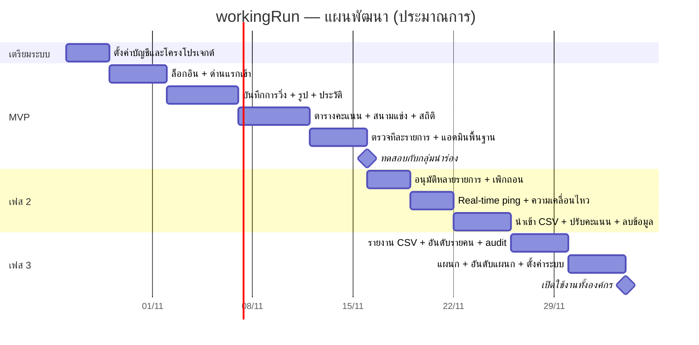

# workingRun — ขั้นที่ 5: แผนพัฒนาแบ่งเฟส

> สถานะ: **รอผู้ใช้ตรวจ**
> ระยะเวลาประมาณการสำหรับนักพัฒนา 1 คนเต็มเวลา (รวมเขียนเทสแล้ว) — งานฝั่งองค์กรทำคู่ขนานได้

## ภาพรวม

| เฟส | สิ่งที่ได้ | เวลาโดยประมาณ |
|---|---|---|
| 0. เตรียมระบบ | บัญชี Supabase / Cloudflare / GitHub, โครงโปรเจกต์, CI | 2–3 วัน |
| **MVP** | บันทึกการวิ่ง + ตารางคะแนน + ตรวจทีละรายการ + แอดมินพื้นฐาน | 3–4 สัปดาห์ |
| **เฟส 2** | อนุมัติหลายรายการ + real-time + เครื่องมือแอดมินเพิ่ม | ~2 สัปดาห์ |
| **เฟส 3** | รายงาน + แผนกและอันดับแผนก | ~1.5–2 สัปดาห์ |
| **รวม** | | **ประมาณ 7–8 สัปดาห์** |

> หมายเหตุ: ฐานข้อมูลทั้งหมด (ขั้นที่ 3) ทำไว้ครบทุกเฟสแล้ว เฟสต่อๆ ไปจึงเป็นงานหน้าเว็บและ API เป็นหลัก

---

## เฟส 0 — เตรียมระบบ

| งาน | ใครทำ |
|---|---|
| สมัคร Supabase (Free) เลือก region Singapore → สร้างโปรเจกต์ | องค์กร (ผมช่วยบอกทีละขั้นได้) |
| สมัคร Cloudflare (Free) → เปิด Workers, R2, Turnstile | องค์กร |
| เลือกโดเมน: ใช้ `workingrun.<ชื่อ>.workers.dev` ฟรี หรือโดเมนบริษัท (ต้องอยู่บน Cloudflare) | องค์กรตัดสินใจ |
| โครงโปรเจกต์ Next.js + TypeScript + OpenNext สำหรับ Cloudflare | นักพัฒนา |
| CI บน GitHub Actions: ตรวจโค้ด + unit test + DB test ทุกครั้งที่ push | นักพัฒนา |
| สำรองฐานข้อมูลรายวัน (GitHub Actions `pg_dump` เข้ารหัส) | นักพัฒนา |

## MVP — บันทึก + ตารางคะแนน

**เป้าหมาย:** พนักงานบันทึกการวิ่งจากมือถือได้ ผู้ตรวจอนุมัติได้ และทุกคนเห็นตารางคะแนนที่อัปเดตเอง

| ส่วน | รายละเอียด |
|---|---|
| ล็อกอิน | รหัสพนักงาน + รหัสผ่าน + Turnstile, ล็อกบัญชีเมื่อผิด 5 ครั้ง, บังคับเปลี่ยนรหัสครั้งแรก, ยอมรับประกาศความเป็นส่วนตัว |
| หน้าหลัก | สนามแข่ง 5 อันดับแรก (นักวิ่งเคลื่อนตามสัดส่วนคะแนน สลับลู่เมื่ออันดับเปลี่ยน), ตารางคะแนนทั้งหมด (แถวเลื่อน, ตัวเลขนับขึ้น, ▲ ขึ้น N อันดับ / ▼ สีเทา), อัปเดตทุก ~10 วินาที |
| สถิติของฉัน | อันดับ, ระยะสะสม, จำนวนครั้ง, คะแนนที่ต้องเพิ่มเพื่อแซงอันดับถัดไป |
| บันทึกการวิ่ง | วันที่, ระยะ (กม.), เวลา, รูป (บีบอัดและลบ GPS ที่มือถือ), ตรวจกฎทันทีก่อนส่ง |
| ประวัติการวิ่ง | สถานะ รอตรวจ/อนุมัติ/ปฏิเสธ (พร้อมเหตุผล), ป้ายธงผิดปกติ, ยกเลิกรายการที่รอตรวจ |
| ผู้ตรวจ | คิวรอตรวจ (รายการติดธงเด่น), ดูรูป, อนุมัติ/ปฏิเสธทีละรายการ |
| แอดมิน | สร้าง/เปิด/ปิดฤดูกาล, ตั้งกติกาคะแนน, เพิ่มผู้ใช้ทีละคน (ได้รหัสผ่านชั่วคราว), รีเซ็ตรหัสผ่าน, จัดการผู้มีสิทธิ์เล่น, กำหนดบทบาท |
| งานอัตโนมัติ | ลบรูปครบ 90 วัน, ลบประวัติล็อกอินเก่า, ping กัน Supabase หลับ |
| ดีไซน์ | RunBoard ครบ: สี ฟอนต์ IBM Plex Sans Thai/Mono, dark mode, ผู้นำเด่นที่สุด, `prefers-reduced-motion`, มือถือเป็นหลัก |
| 2 ภาษา | ไทย/อังกฤษ, วันที่ "16 ต.ค. 2569", เวลา "14:25 น." |

**Unit test ที่ต้องมี (ตามที่ขอในขั้นที่ 6):** คำนวณคะแนน, จัดอันดับ + อันดับเท่ากัน, กฎห้ามส่ง, กฎติดธง, จัดรูปแบบวันที่ พ.ศ./เวลาไทย, คำนวณการเคลื่อนที่ของนักวิ่งในสนามแข่ง

**เกณฑ์ผ่าน (ก่อนให้กลุ่มนำร่องใช้):**
- [ ] พนักงานบันทึกการวิ่งจากมือถือจนเสร็จได้ภายใน 1 นาที
- [ ] รายการที่อนุมัติขึ้นบนตารางคะแนนของทุกคนภายใน 15 วินาที
- [ ] หน้าหลักโหลดบนมือถือ 4G ภายใน 3 วินาที
- [ ] เทสทั้งหมดผ่านใน CI
- [ ] ผ่านการทดสอบการเข้าถึง (คอนทราสต์สี, ใช้คีย์บอร์ดได้, ปิดแอนิเมชันตามการตั้งค่า)

**กลุ่มนำร่อง (1 สัปดาห์):** 20–30 คน + ผู้ตรวจ 2 คน ใช้ฤดูกาลทดลอง แล้วเก็บความเห็นก่อนเปิดทั้งองค์กร

## เฟส 2 — ระบบอนุมัติเต็มรูปแบบ + real-time

| ส่วน | รายละเอียด |
|---|---|
| อนุมัติหลายรายการ | เลือกหลายรายการ → อนุมัติ/ปฏิเสธพร้อมกัน (สูงสุด 200, สำเร็จทั้งหมดหรือไม่มีเลย), ตัวกรองตามธง |
| เพิกถอน | ยกเลิกคะแนนของรายการที่อนุมัติไปแล้ว พร้อมเหตุผล |
| Real-time | Supabase Realtime ส่งสัญญาณ "มีข้อมูลใหม่" → ตารางอัปเดตแทบทันที (ถ้าเกิน 200 คนพร้อมกัน ใช้การเช็กทุก 10 วินาทีแทนอัตโนมัติ) |
| แถบความเคลื่อนไหว | "ธนพล ส. วิ่ง 3.0 กม. +30" เลื่อนบนหน้าหลัก |
| นำเข้าพนักงานจาก CSV | เพิ่มทีละหลายร้อยคน ได้ไฟล์รหัสผ่านชั่วคราวกลับมา |
| ปรับคะแนนด้วยมือ | บวก/ลบ พร้อมเหตุผล (บันทึกว่าใครทำ เมื่อไหร่) |
| คำขอลบข้อมูล | พนักงานกดขอ → แอดมินดำเนินการ (ปิดบัญชี + ลบรูป, เก็บประวัติคะแนน) |
| คำนวณคะแนนย้อนหลัง | เมื่อแอดมินเปลี่ยนแต้ม/กม. กลางฤดูกาล |

**เกณฑ์ผ่าน:** ผู้ตรวจเคลียร์คิว 100 รายการได้ภายใน 10 นาที · ผู้ชม 200 คนพร้อมกันเห็นการอัปเดตภายใน 2 วินาที

## เฟส 3 — รายงานและอันดับแผนก

| ส่วน | รายละเอียด |
|---|---|
| ส่งออก CSV | ตารางคะแนน / รายการวิ่งทั้งหมด / สมุดคะแนน — เปิดใน Excel ภาษาไทยไม่เพี้ยน |
| ดูอันดับรายคน | สถิติ ประวัติการวิ่ง และทุกการเปลี่ยนแปลงคะแนนของคนนั้น |
| บันทึกตรวจสอบ | ค้นได้ว่าใครเปลี่ยนอะไร เมื่อไหร่ เพราะอะไร |
| จัดการแผนก | เพิ่ม/แก้/ลบแผนก, ย้ายพนักงานเข้าแผนก |
| อันดับแผนก | ตารางแผนก + แท็บสลับ "รายคน / รายแผนก" บนหน้าหลัก ⚠️ ต้องเลือกวิธีคิด (ดูคำถามด้านล่าง) |
| ตั้งค่าระบบ | ระยะเก็บรูป/บันทึก, เกณฑ์ล็อกบัญชี, เวอร์ชันประกาศความเป็นส่วนตัว |

---

## งานฝั่งองค์กร (ทำคู่ขนาน)

| ก่อน | งาน |
|---|---|
| เริ่ม MVP | สมัคร Supabase + Cloudflare (ฟรี), ตัดสินใจเรื่องโดเมน |
| กลุ่มนำร่อง | รายชื่อกลุ่มนำร่อง 20–30 คน, ผู้ตรวจ 2 คน, **ข้อความประกาศความเป็นส่วนตัว** (ระบุว่าเก็บข้อมูลจนจบโครงการ และลบรูปเมื่อครบ 90 วัน) |
| เปิดทั้งองค์กร | ไฟล์รายชื่อพนักงาน (รหัสพนักงาน, ชื่อที่แสดง, แผนก), วิธีแจกรหัสผ่านชั่วคราว, ประกาศกติกากิจกรรม |
| จบโครงการ | ส่งออก CSV ผลทุกฤดูกาลเก็บไว้ → ลบโปรเจกต์ Supabase + Cloudflare (ข้อมูลหายทั้งหมด) |

## ความเสี่ยงและวิธีรับมือ

| ความเสี่ยง | ผลกระทบ | วิธีรับมือ |
|---|---|---|
| คนดูพร้อมกันเกิน 200 คน (เช่น ประกาศผลในที่ประชุม) | real-time ping เต็ม | ระบบสลับไปเช็กทุก 10 วินาทีเอง ตารางยังอัปเดต |
| ใช้งาน Workers เกินโควต้าฟรี (100,000 คำขอ/วัน) | หน้าเว็บช้าหรือใช้ไม่ได้ช่วงท้ายวัน | 1000 คน × เปิด ~30 นาที/วัน ≈ 180,000 คำขอ ⚠️ อาจเกิน → หยุดเช็กเมื่อแท็บไม่ได้เปิดดู, เช็กทุก 15 วิเมื่อไม่มีการอนุมัติ, ถ้ายังเกินใช้ Workers Paid $5/เดือน |
| ที่เก็บรูปเกิน 10 GB | อัปโหลดไม่ได้ | บีบอัดรูป ~150 KB + ลบทุก 90 วัน ≈ 2 GB · มีหน้าแอดมินแสดงพื้นที่ที่ใช้ |
| Supabase Free หยุดทำงานเมื่อไม่มีคนใช้ 7 วัน | ระบบหลับช่วงพักฤดูกาล | ping รายวัน |
| ผู้ตรวจไม่พอ คิวค้าง | ปิดฤดูกาลไม่ได้ | หน้าแอดมินแสดงจำนวนค้าง + อนุมัติหลายรายการในเฟส 2 |
| ข้อมูลหาย | — | สำรองรายวัน เก็บ 30 วัน |

## ⚠️ คำถามสำหรับเฟส 3 (ยังไม่ต้องตอบตอนนี้)

**อันดับแผนกคิดอย่างไร?** แผนกมีคนไม่เท่ากัน
- (ก) **คะแนนเฉลี่ยต่อคน** — ยุติธรรมกับแผนกเล็ก *(แนะนำ)*
- (ข) คะแนนรวม — แผนกใหญ่ได้เปรียบ
- (ค) เฉลี่ยเฉพาะคนที่วิ่งอย่างน้อย 1 ครั้ง

---

## เทคนิคที่จะใช้ในขั้นที่ 6 (MVP)

| เรื่อง | เลือกใช้ |
|---|---|
| เฟรมเวิร์ก | Next.js 15 (App Router) + TypeScript (strict) |
| รันบน Cloudflare | `@opennextjs/cloudflare` + Wrangler |
| เชื่อม Supabase | `@supabase/ssr` (session ในคุกกี้) |
| สไตล์ | CSS Modules + CSS variables (design tokens ของ RunBoard) — ไม่ใช้ไลบรารี UI หนักๆ |
| 2 ภาษา | `next-intl` |
| แอนิเมชัน | CSS transform + เทคนิค FLIP (เบา, ปิดได้ตาม `prefers-reduced-motion`) |
| ตรวจข้อมูล | `zod` (ใช้ schema เดียวกันทั้งฟอร์มและ API) |
| เทส | Vitest (unit) + สคริปต์ DB test เดิม · Playwright (end-to-end, เพิ่มในเฟส 2) |
| ตรวจโค้ด | ESLint + Prettier + `tsc --noEmit` ใน CI |

**ลำดับงานในขั้นที่ 6:** เริ่มจาก "ตรรกะหลัก" ที่ไม่ขึ้นกับหน้าเว็บก่อน (คำนวณคะแนน, จัดอันดับ, กฎห้ามส่ง/ติดธง, วันที่ไทย, ตำแหน่งนักวิ่ง) พร้อม unit test → จากนั้นต่อ API → หน้าเว็บ
ตรรกะชุดเดียวกันนี้ใช้ทั้งตรวจที่ฟอร์ม (บอกผู้ใช้ทันที) และในเทส เทียบกับผลจากฐานข้อมูลเพื่อให้กฎตรงกันสองฝั่ง
