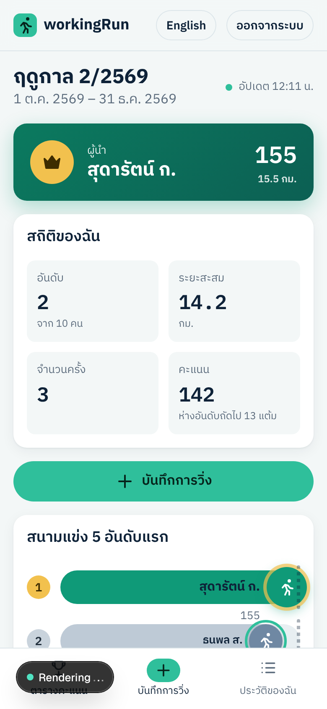
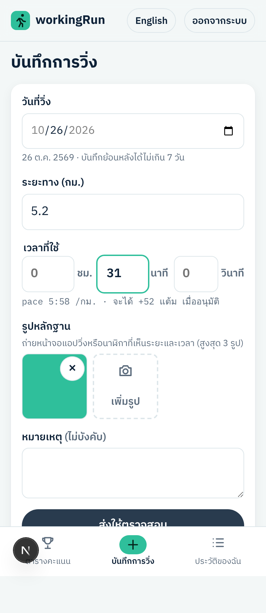
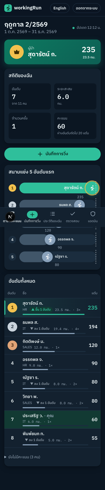
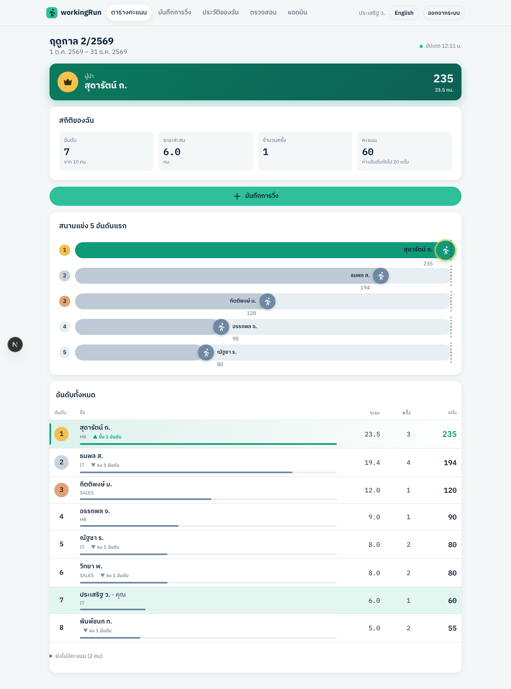
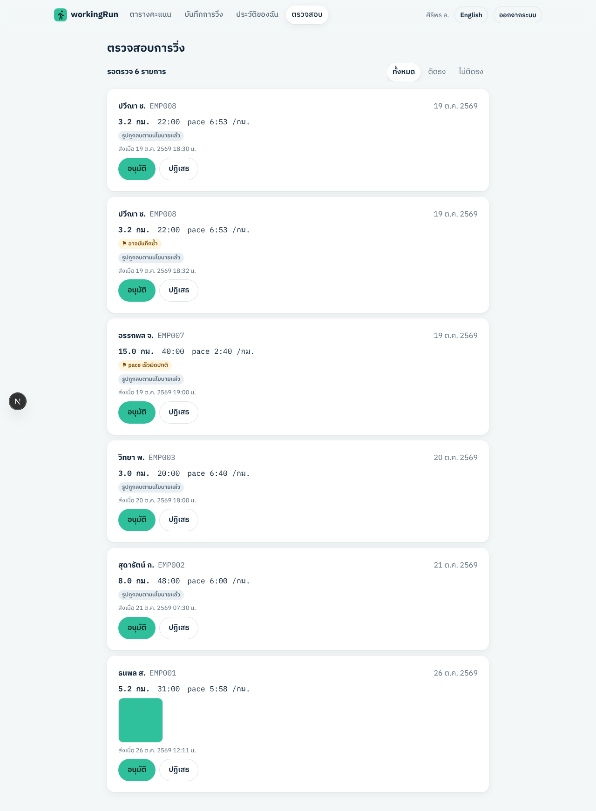
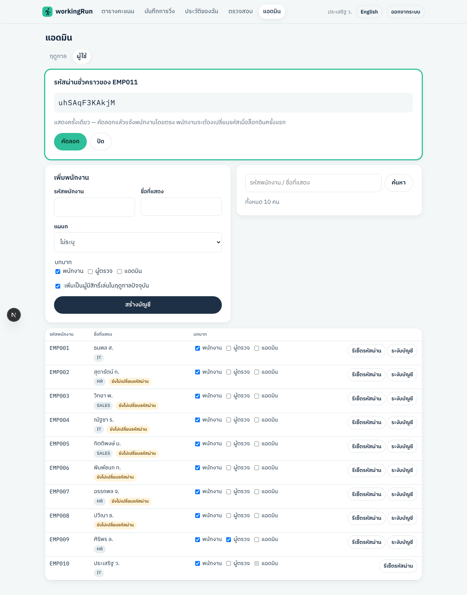

# workingRun — ขั้นที่ 6: โค้ด MVP

> สถานะ: **รอผู้ใช้ตรวจ**

## สรุปแบบภาษาธรรมดา

MVP ใช้งานได้ครบตามแผนในขั้นที่ 5 และทดสอบแล้ว 3 ระดับ:

| ระดับ | ทดสอบอะไร | ผล |
|---|---|---|
| **Unit test** (124 ข้อ) | ตรรกะคำนวณล้วนๆ: คะแนน, การจัดอันดับ, อันดับเท่ากัน, กฎห้ามส่ง, กฎติดธง, วันที่ พ.ศ., สนามแข่ง, รหัสผ่าน, งานลบรูปรายวัน, ข้อความ 2 ภาษาครบทุกรหัส error | ✅ ผ่านทั้งหมด |
| **ฐานข้อมูล** (59 ข้อ) | กฎในฐานข้อมูล + สิทธิ์ของแต่ละบทบาท — รันทั้งบน Postgres 16 และ **Supabase จริงบนเครื่อง (Postgres 17)** | ✅ ผ่านทั้งหมด |
| **End-to-end** (34 ข้อ) | เปิดเบราว์เซอร์จริงใช้งานเหมือนคน: ล็อกอินครั้งแรก → เปลี่ยนรหัส → ยอมรับประกาศ → บันทึกการวิ่งพร้อมรูป → ผู้ตรวจอนุมัติ → ตารางคะแนนของอีกเครื่องอัปเดตเองภายใน 25 วินาที | ✅ 34/34 |

นอกจากนี้: build สำหรับ Cloudflare ผ่าน (ขนาด 2.2 MB บีบอัด — ต่ำกว่าเพดานแพ็กเกจฟรี 3 MB), lint และ typecheck ผ่าน

### ภาพหน้าจอ (จากการทดสอบจริง)

| มือถือ | บันทึกการวิ่ง | โหมดมืด |
|---|---|---|
|  |  |  |

| คอมพิวเตอร์ (หลังอนุมัติ — ▲/▼) | คิวผู้ตรวจ | แอดมิน: สร้างบัญชี |
|---|---|---|
|  |  |  |

## สิ่งที่ทำได้ใน MVP

**พนักงาน**
- ล็อกอินด้วยรหัสพนักงาน + Cloudflare Turnstile · ล็อกบัญชี 15 นาทีเมื่อผิด 5 ครั้ง
- ครั้งแรก: บังคับเปลี่ยนรหัสผ่าน (เช็กเงื่อนไขทันทีขณะพิมพ์) → ยอมรับประกาศความเป็นส่วนตัว
- **หน้าหลัก:** แถบผู้นำ (เด่นที่สุด), สถิติของฉัน (อันดับ ระยะ จำนวนครั้ง แต้ม ห่างอันดับถัดไปกี่แต้ม), สนามแข่ง 5 อันดับแรก (นักวิ่งอยู่ตามสัดส่วนคะแนน สลับลู่เมื่ออันดับเปลี่ยน), ตารางคะแนนทั้งหมด (แถวเลื่อน ตัวเลขนับขึ้น ▲ ขึ้น N อันดับ / ▼ สีเทา), อัปเดตเองทุก ~10 วินาทีขณะเปิดดู
- **บันทึกการวิ่ง:** เลือกวันที่ได้เฉพาะช่วงที่อนุญาต, แสดง pace และแต้มที่จะได้ทันที, แนบรูป 1–3 รูป (มือถือย่อรูปและลบ GPS ก่อนส่ง), บอกทุกข้อผิดพลาดก่อนส่ง, กันกดส่งซ้ำเมื่อเน็ตหลุด
- **ประวัติ:** สถานะ รอตรวจ/อนุมัติ/ปฏิเสธ พร้อมเหตุผล, ป้ายธงผิดปกติ, ยกเลิกรายการที่รอตรวจ

**ผู้ตรวจ:** คิวรอตรวจ (เก่าสุดก่อน) + กรองติดธง/ไม่ติดธง, ดูรูป, อนุมัติ/ปฏิเสธ (ต้องใส่เหตุผล), ไม่เห็นรายการของตัวเองในคิว

**แอดมิน:** สร้าง/เปิด/ปิดฤดูกาล (ปิดได้เมื่อตรวจครบ), ตั้งกติกาเวอร์ชันใหม่ (+ คำนวณย้อนหลัง), เพิ่ม/ถอนผู้มีสิทธิ์ด้วยรหัสพนักงาน, เพิ่มพนักงานทีละคน (ได้รหัสผ่านชั่วคราว), รีเซ็ตรหัสผ่าน, กำหนดบทบาท, ระงับบัญชี

**ระบบ:** 2 ภาษา (สลับได้ที่เมนู), dark mode ตามเครื่อง, ปิดแอนิเมชันเมื่อเครื่องตั้ง "ลดการเคลื่อนไหว", งานรายวันลบรูปครบ 90 วัน + ไฟล์ที่อัปโหลดค้าง + audit log เก่า

## ปัญหาที่การทดสอบจับได้และแก้แล้ว

1. **ตั้งค่า Supabase ผิดจะล็อกอินไม่ได้ทั้งระบบ:** การปิด "สมัครด้วยอีเมล" ใน Supabase ปิดการล็อกอินด้วยอีเมล/รหัสผ่านไปด้วย — ต้องปิดเฉพาะ "Allow new users to sign up" (ระดับรวม) แทน แก้ใน `supabase/config.toml` และเขียนขั้นตอนไว้ใน README แล้ว ทดสอบแล้วว่าล็อกอินได้และ **สมัครเองไม่ได้**
2. รหัส error 7 ตัวยังไม่มีข้อความแปล (เทสตรวจข้อความจับได้) — เพิ่มแล้ว
3. ตัวอักษรขาวบนแถบผู้นำสีมิ้นต์ในโหมดมืดอ่านยาก — เปลี่ยนเป็นเขียวเข้ม
4. รูปหลักฐานที่ไม่มีไฟล์แสดงเป็นไอคอนรูปเสีย — แสดงข้อความแทน
5. ส่วนหัวบนมือถือแน่นเกิน — ซ่อนชื่อผู้ใช้บนจอเล็ก

## ข้อจำกัดของการทดสอบ (ตรงไปตรงมา)

- **ยังไม่ได้ทดสอบบน Cloudflare จริง** — ทดสอบด้วย Next.js บนเครื่อง + R2 จำลอง และตรวจว่า bundle ของ Worker build ได้ ต้องลองอีกครั้งหลังสมัคร Cloudflare
- **Turnstile:** sandbox ที่ผมใช้เข้าเซิร์ฟเวอร์ของ Cloudflare ไม่ได้ จึงใช้ตัวจำลองตอนทดสอบ (โค้ด production เรียก Cloudflare เสมอ — ค่าที่ใช้ชี้ไปตัวจำลองถูกละเลยใน production)
- ยังไม่ได้ทดสอบกับคนจำนวนมากพร้อมกัน (load test) และ Safari บน iPhone จริง — แนะนำให้กลุ่มนำร่องลองบน iPhone/Android

## สิ่งที่ต้องรู้ก่อนเปิดใช้จริง

1. **Rate limit การล็อกอินของ Supabase:** คำขอล็อกอินทุกคนมาจาก IP ของ Cloudflare ชุดเดียวกัน — ค่าเริ่มต้น 30 ครั้ง/5 นาที ไม่พอสำหรับช่วงเช้าที่คนล็อกอินพร้อมกัน **ต้องเพิ่มใน Dashboard** (Authentication → Rate Limits)
2. ข้อความประกาศความเป็นส่วนตัวใน `messages/th.json` (`consent.body`) เป็นร่าง — ฝ่ายกฎหมาย/DPO ควรแก้
3. แอดมินคนแรกต้องสร้างด้วย SQL ครั้งเดียว (ขั้นตอนใน README)

## ไฟล์สำคัญ

| ไฟล์ | เนื้อหา |
|---|---|
| `src/lib/domain/` | ตรรกะหลัก + unit test (`*.test.ts`) — คะแนน `scoring.ts`, อันดับ `ranking.ts`, กฎ `runRules.ts`, วันที่ `datetime.ts`, สนามแข่ง `raceTrack.ts` |
| `src/lib/server/services/` | ตรรกะฝั่ง server แยกตามหน้าที่ (runs, review, admin, leaderboard, auth) |
| `src/app/api/v1/` | API ตาม OpenAPI (ส่วนของ MVP) |
| `src/components/RaceTrack.tsx`, `LeaderboardTable.tsx`, `LiveBoard.tsx` | สนามแข่ง ตารางคะแนน และการอัปเดตอัตโนมัติ |
| `src/cron/jobs.ts` | งานรายวัน (ลบรูป 90 วัน ฯลฯ) + เทส |
| `worker.ts`, `wrangler.jsonc` | ตั้งค่า Cloudflare Worker, R2, Cron |
| `e2e/smoke.mjs` | สคริปต์ทดสอบ end-to-end |
| `.github/workflows/ci.yml` | CI: lint, typecheck, unit test, build, DB test ทุกครั้งที่ push |

## การเปลี่ยนแปลงจากขั้นก่อน

- ใช้ **Next.js 16** (แทน 15 ในแผน) — เวอร์ชันล่าสุดที่ OpenNext สำหรับ Cloudflare รองรับ
- สไตล์รวมไว้ใน `globals.css` ไฟล์เดียว (แทน CSS Modules) — ระบบไม่ใหญ่ ดูแลง่ายกว่า
- แก้ migration เดิม (ยังไม่เคย deploy ที่ไหน): `runs.client_request_id` กันส่งซ้ำ, view `season_roster` สำหรับรายชื่อผู้ที่ยังไม่มีคะแนน, ผู้ตรวจอ่านชื่อ/รหัสพนักงานของเจ้าของรายการได้
- ป้าย "ใหม่" แสดงเฉพาะคนที่เพิ่งเข้าตารางระหว่างที่เปิดหน้าอยู่ (ไม่งั้นทุกคนจะมีป้าย "ใหม่" ตลอดฤดูกาล)

## รันบนเครื่อง

ดู [README](../README.md) — สรุป: `npm ci` → `npx supabase start` → ตั้ง `.env.local` → `npm run dev` → เปิด http://localhost:3000 ล็อกอิน `EMP001` / `WorkingRun#2569`
